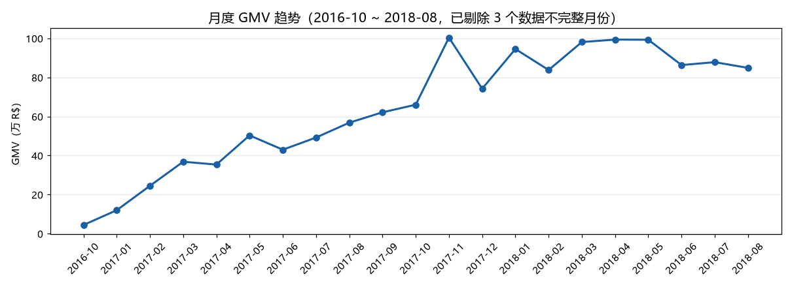
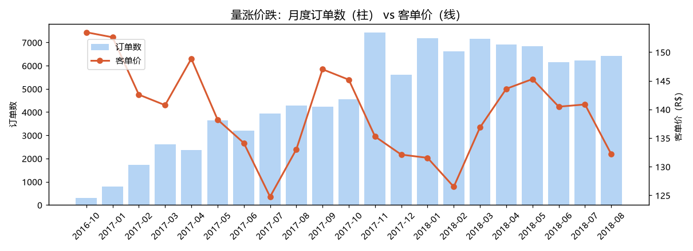
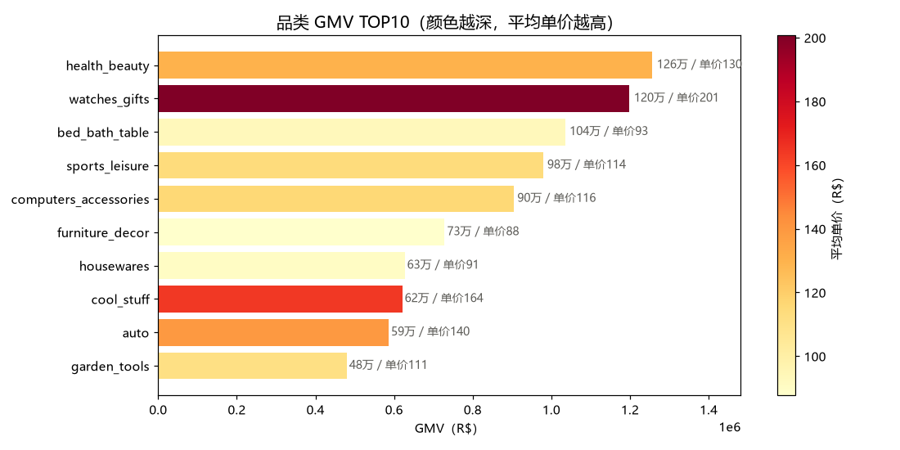
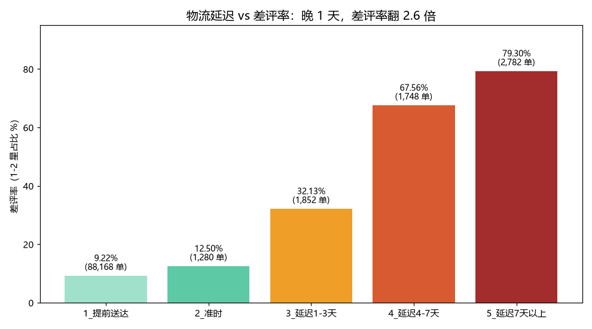
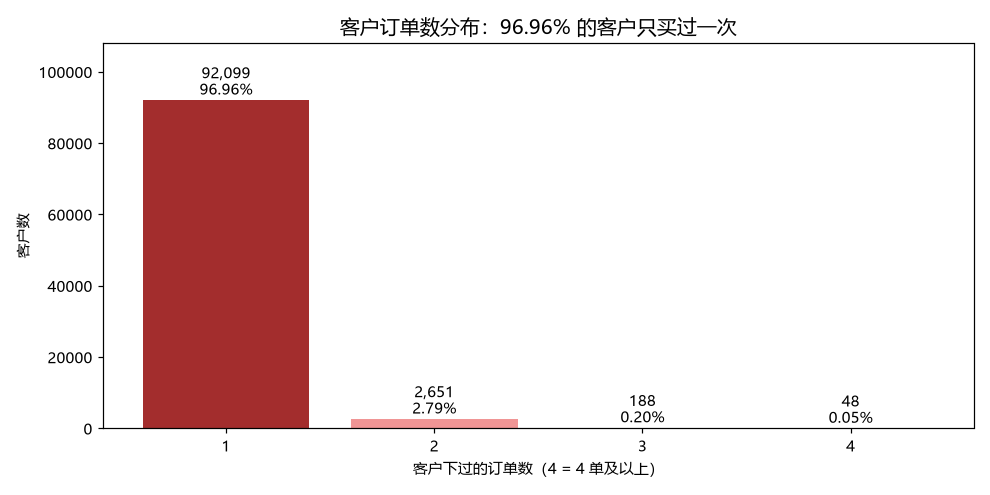
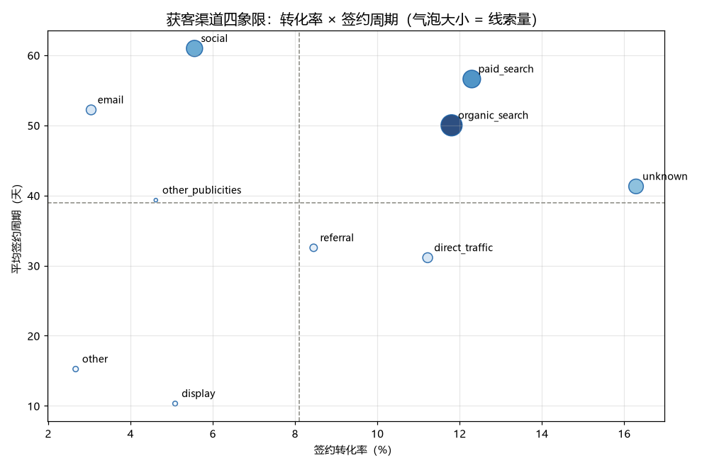
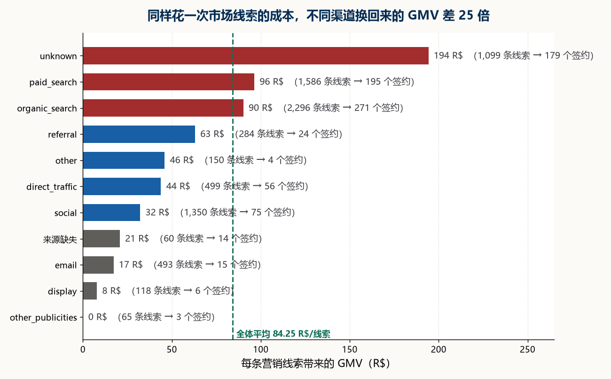
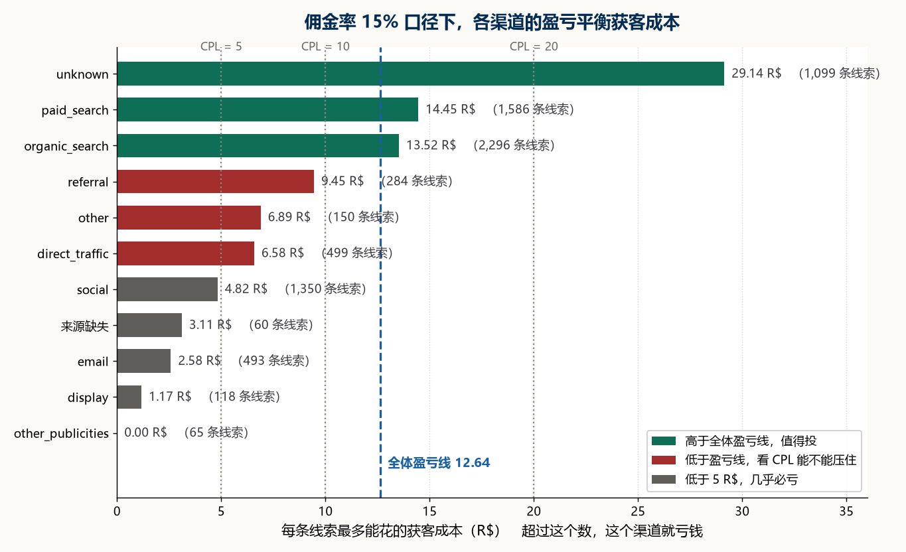
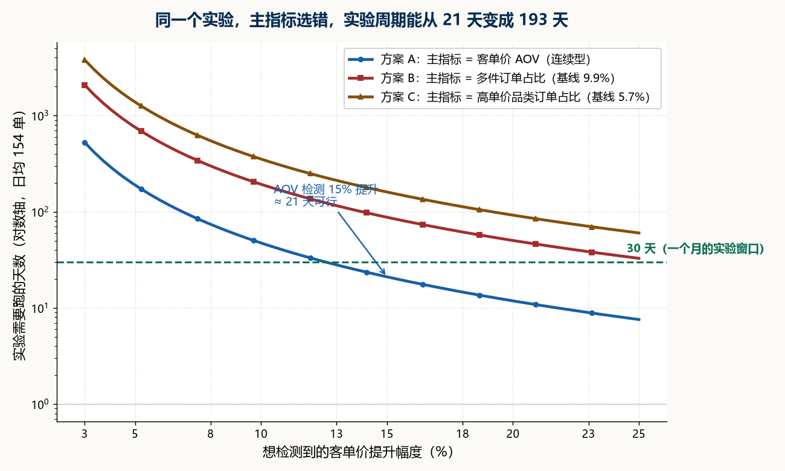
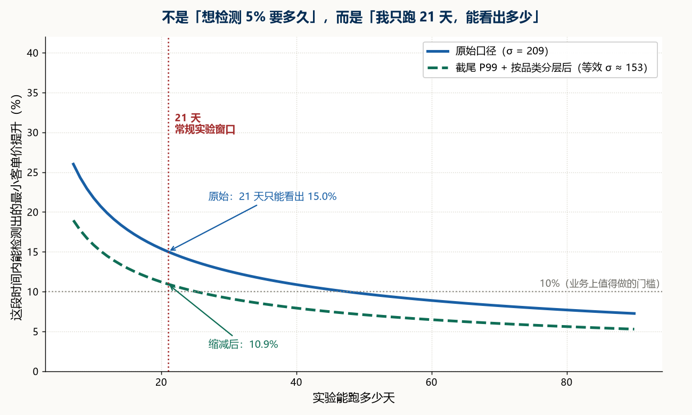

# 跨境电商平台（Olist）GMV 拆解与增长质量诊断

对巴西电商平台 **Olist** 做经营复盘：GMV 两年涨了 9.4 倍，但这轮增长是否健康？

**结论：不健康。增长靠拉新和低价冲量，单客价值在稀释。**

| 指标 | 数值 |
|---|---|
| 有效 GMV（商品口径） | **13,494,400.74 R$** |
| 有效订单 | **98,199** |
| 客单价 | **137.42**（商品）/ 160.24（含运费） |
| 连带率 | **1.14** |
| 复购率 | **3.04%** |
| 品类 CR5 | **39.77%** |

数据区间 2016-09 ~ 2018-08，有效分析区间 **2016-10 ~ 2018-08**
（2016-09 仅 2 单、2016-12 仅 1 单、2018-09 仅 1 单，残月剔除）

---

## 一、三个数字，串起整个结论

**单量涨 9.4 倍 × 客单价跌 13.4% × 复购率仅 3.04%**

- 月订单量从 2017-01 的 787 单涨到 2017-11 的 7,421 单
- 同期客单价从 152.60 跌到 132.11
- 94,986 个客户里，只有 2,887 人下过 2 单及以上

→ **量在爆，价在跌，人不回头。** 这是典型的拉新驱动，不是复购驱动。







---

## 二、推翻了一个假设：物流不是复购低的原因

看到复购率只有 3.04%，第一反应是物流太差把人赶跑了。数据说不是：

| 送达情况 | 订单数 | 平均评分 | 差评率 |
|---|---|---|---|
| 提前送达 | 88,168（92%） | 4.29 | 9.22% |
| 准时送达 | 1,280（1.3%） | 4.03 | 12.50% |
| 延迟 1-3 天 | 1,852 | 3.29 | 32.13% |
| 延迟 4-7 天 | 1,748 | 2.11 | 67.56% |
| 延迟 7 天以上 | 2,782（2.9%） | 1.70 | **79.30%** |

- 92% 订单提前送达（承诺时间给得极宽松），绝大多数人体验良好
- 延迟 7 天以上的只占 2.9%，但**组内差评率 79.3%**——小概率、高杀伤
- 这批订单约占全平台差评的 23%，解释不了 3.04% 的低复购

→ 真因更可能是**品类本身低频**（家具家居买了用好几年）+ 获客质量。





---

## 三、获客渠道：招来的卖家一半是僵尸

漏斗：**8,000 线索 → 842 签约 → 379 出过单**

- 签约率 10.53%
- **463 家（54.99%）从没卖出过一单**
- 这批渠道卖家合计 GMV 674,005.39，**只占全平台 4.99%**

→ 典型的「重签约、轻激活」。KPI 挂签约数，招进来一半是僵尸。





### 渠道质量与盈亏平衡获客成本

数据里没有投放成本，所以不算 ROI，只算**收益率倒推的盈亏平衡获客成本**（breakeven CPL）。
假设平台佣金率 15%，则平台收入 = GMV × 15%，盈亏线 = 平台收入 ÷ 线索数：

| 渠道 | 签约数 | 转化率 | 平均转化天数 | 盈亏平衡 CPL (R$) |
|---|---|---|---|---|
| unknown | 1,099 | 16.29% | 41.3 | 29.14 |
| paid_search | 1,586 | 12.30% | 56.6 | 14.45 |
| organic_search | 2,296 | 11.80% | 50.0 | 13.52 |
| referral | 284 | 8.45% | 32.5 | 9.45 |
| direct_traffic | 499 | 11.22% | 31.1 | 6.58 |
| social | 1,350 | 5.56% | 61.0 | **4.82** |
| email | 493 | 3.04% | 52.2 | **2.58** |
| display | 118 | 5.08% | — | **1.17** |
| **全体** | **842** | **10.53%** | — | **12.64** |

→ **social / email / display 在任何合理 CPL 下都亏**；paid_search 是可投放渠道里最优的；
social 还双重糟糕（转化 5.56% + 周期 61 天，两个都垫底）。

> 注：佣金率 15% 是外部假设（行业区间 10~20%），已做 CPL 敏感性分析（5/10/20/50 R$ 四档），
> 结论在合理区间内不翻转。



---

## 四、A/B 实验方案（设计了，未执行）

观察到 watches_gifts 客单价 200.70，是 bed_bath_table 的 2.15 倍。
能不能建议多推它来拉客单价？**不能——这是观察数据，存在选择偏差**
（买手表的人本来就有钱，不是手表让他们变有钱）。要验证只能做实验。

反向 MDE 思路：不是「想检测 5% 要多久」，而是「只有 21 天，能看出多少」。

| 方案 | 方差处理 | 21 天可检测 MDE |
|---|---|---|
| 原始 | σ = 209.31 | **15.0%** |
| 截尾 P99 | σ → 155.34（省 40% 样本） | ≈ 12% |
| 截尾 + 品类分层 | 再省 11.6% | **10.9%** |

其他设计点：

- **主指标**：客单价 AOV（若选二值指标，周期从 47 天拉到 193 天，差 10 倍）
- **分流单元**：`customer_unique_id` 哈希取模（同一人始终同组，避免跨组比价）
- **分析单元**：订单（复购率仅 3.04%，聚类效应影响不到 4%，可按独立样本近似）
- **CUPED 失效**：97% 的人只有一单，没有「实验前」数据做协变量
- **护栏指标**：不用差评率（评价滞后，检测 3pp 恶化需 28 天），改用**当日可观测的延迟率**
- **不上线条件**：p > 0.05 / 护栏恶化 / 效应小于 MDE 且无法排除噪音

> **本项目只做了方案设计，没有真实流量执行。**





---

## 五、落地建议

1. **渠道 KPI 由签约数改为首单出单数**——治 54.99% 的僵尸卖家
2. **以高单价品类拉 AOV**——连带率 1.14 → 1.3
3. **物流资源压向延迟 4 天以上的长尾单**——只占少数订单，却吃掉大量差评

---

## 六、仓库结构

```
├── README.md
├── py/                     Python：口径固化 + 7 张底表的加工
│   ├── 01_固化口径.py        剔除无效单 / 归月 / GMV 只计商品价
│   ├── 02_底表D_评价.py      按订单去重
│   ├── 03_底表E_渠道.py      营销线索 → 签约漏斗
│   ├── 04_底表F_物流评价.py  延迟天数 × 评分
│   ├── 05_底表G_客户复购.py  按 customer_unique_id 聚合
│   ├── 12_线索价值与AB方案.py
│   └── 13_渠道ROI与AB实验设计.py
├── sql/
│   └── core_queries.sql   7 个核心查询（月度趋势 / 量价 / 品类 / 渠道 / 物流 / 复购 / ROI）
├── outputs/               结论表：渠道明细、渠道 ROI、线索价值
├── docs/
│   └── 字段字典_底表.csv   7 张底表的字段说明
└── img 说明：10 张分析图位于根目录，供上方 README 直接引用
```

**跑起来需要什么**：`pandas`、`numpy`、`matplotlib`、MySQL 8.0。
脚本里的 `BASE` 用 `pathlib` 自动定位到项目根目录，**下载后不用改任何路径**。

---

## 七、七张底表与关键口径

| 底表 | 行数 | 用途 |
|---|---|---|
| 底表A_订单 | 99,441 | 订单主表 + 有效性标记 |
| 底表B_订单明细 | 112,101 | 商品明细（一单多行，统计订单数须去重） |
| 底表C_客户 | 99,441 | 客户维度 |
| 底表D_评价 | 98,673 | 按订单去重后的评价 |
| 底表E_渠道 | 8,000 | 营销线索 → 签约漏斗 |
| 底表F_物流评价 | 95,830 | 延迟天数 × 评分 |
| 底表G_客户复购 | 94,986 | 按 customer_unique_id 聚合 |

### 关键口径（三条，写死在代码里）

1. **有效订单**：剔除 `canceled` / `unavailable` / `created` 三类状态 → 98,199 单
2. **归月**：按**下单时间**归月，不按送达时间（否则会失真）
3. **GMV**：默认只计商品价（`price`），不含运费；算平台收入时才用含运费口径

---

## 八、踩过的坑

1. **`customer_id` 不是人**。它是一次下单的编号，同一人下两单有两个 id。
   用错则复购率恒为 0，要用 `customer_unique_id`。
2. **订单数必须 `COUNT(DISTINCT order_id)`**。明细表一单多行，直接 `COUNT(*)` 会虚高 14%。
3. **评价表要先按订单去重**（99,224 → 98,673），否则 JOIN 后差评率被放大。
4. **分子分母要同源**。GMV 和订单数必须来自同一批订单，否则客单价偏差（98,202 vs 98,199）。
5. **残月要剔**。2016-09 只有 2 单，放进趋势图会造出一个假的低点。
6. **Python `groupby` 默认丢弃 NaN**。60 条 origin 为空的线索被吞掉，
   只剩 10 行渠道，MySQL 里是 11 行——以后者为准。

---

## 九、工具分工

没有为了用某个工具而用它——每一步都有明确的不可替代性。

| 工具 | 用在哪 | 为什么 |
|---|---|---|
| Excel | 探索阶段 | 快，拖一下就能看出趋势 |
| Python (pandas) | 口径固化 + 底表 | 规则多了脑子记不住，换批数据脚本能直接跑 |
| MySQL | 多表关联、聚合 | 复杂聚合 SQL 比 pandas 写得清楚 |
| Tableau | 出图 | 能发链接给别人看 |
| matplotlib | 静态图 | 报告里要固定图 |

---

## 数据来源

[Brazilian E-Commerce Public Dataset by Olist](https://www.kaggle.com/datasets/olistbr/brazilian-ecommerce)
（Kaggle，公开脱敏数据集）

原始 11 张 CSV 约 120 MB，体积较大不随仓库提供，按上面链接可自行下载，放到 `raw/` 下即可复现。

**结论不外推平台整体**——这是公开数据集的复盘，不是给平台做的咨询。

---

*李境 · 2026 年 10 月*
